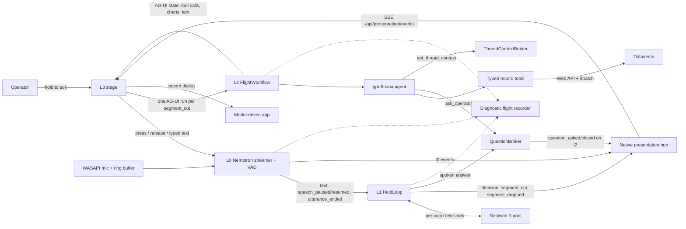

# SpeedOfThought architecture

## Purpose

SpeedOfThought is a voice-driven prototype for working with Dataverse records. The operator holds a
push-to-talk button and speaks several requests in a row. A fast decision model ("System 1")
classifies the speech on every word and cuts it into requests at the operator's pauses. Each cut
request launches an agent run ("flight", "System 2") that executes it against Dataverse with typed
record tools. Flights run in parallel while the operator keeps talking, can build on the previous
request ("export those"), and can ask the operator a question that is answered by voice.

Scope is records only, in an environment with the Contoso Bikes demo tables: list/search,
count/aggregate, charts, get, open in the business app, create, update and delete (single or bulk
by filter), and export to CSV. Metadata, solutions, administration, security and record
associations are out of scope. Writes are approved automatically. Setup is in the
[README](../README.md).

## Stack

| Concern | Implementation |
| --- | --- |
| L0 speech-to-text | `nvidia/nemotron-3.5-asr-streaming-0.6b`, local CUDA, 320 ms tier, Transformers 5.15 |
| L1 intent | `Microsoft-Decision-1` on Azure AI Foundry, one or more deployments |
| L2 execution | `gpt-6-luna` on Azure AI Foundry, Responses API, reasoning effort `low` |
| Agent runtime | Microsoft Agent Framework core 1.13, OpenAI provider 1.12, AG-UI adapter 1.0.1 |
| Dataverse access | Own async Web API client (`httpx`), Azure CLI token, `$batch` change sets |
| Backend | Python 3.12, FastAPI, Uvicorn, one process on `127.0.0.1:8000` |
| L3 presentation | Next.js 16.3, React 19.2, CopilotKit 1.67 (`useAgent`), port 3000 |
| Environment | Dataverse with the Contoso Bikes tables, set by `[l2] dataverse_url` and `tenant_id` |

Python packages: `sot_streamer` (L0), `sot_intent` (L1), `sot_agent` (composition root, L2
flights, AG-UI, diagnostics), `sot_dataverse` (schema, record tools, snapshot/restore).

## Layers and data flow

| Layer | Responsibility | Main code |
| --- | --- | --- |
| L0 | Microphone ring buffer, push-to-talk clips, streaming transcript, speech pauses | `sot_streamer.Streamer`, `audio/vad.py` |
| L1 | One decision per batch of new words, pause-based cuts, thread numbering, handoff | `sot_intent.hold.HoldLoop`, `decision.py`, `threads.py` |
| L2 | One `gpt-6-luna` flight per cut, typed record tools, questions, thread context | `sot_agent.flights`, `flight_workflow`, `sot_dataverse` |
| L3 | Intent band, stacked flight cards with charts, record dialog, `/admin`, `/diagnostics` | `apps/presentation` |

Two channels connect the backend to L3:

- **Native SSE** (`GET /api/presentation/events`) carries `l0`, `l1` and `l2` envelopes. L0/L1 run
  before any agent run exists and have transcript-revision semantics, so they do not use AG-UI.
- **AG-UI** (`POST /ag-ui`, proxied by CopilotKit at `/api/copilotkit`) carries one run per flight.

L3 does not decide anything. It launches a flight for each `segment_cut` that belongs to its own
presentation session and does not answer a waiting question.

## L0: streaming transcription

`sot_streamer.Streamer` owns the model, WASAPI capture, 16 kHz resampling, press/release control,
local Nemotron inference, a second-pass finalization, and versioned events (`utterance_started`,
`text_appended`, `speech_paused`, `speech_resumed`, `utterance_ended`, `utterance_finalized`,
`utterance_cancelled`, `streamer_ready`, `streamer_error`).

- **Ring buffer.** The microphone is initialized lazily by L3 and stays armed. A press starts an
  utterance with 800 ms of pre-roll already captured; a release adds a 300 ms tail. Holds shorter
  than 150 ms are discarded (`too_short`) before L1.
- **Text.** `text_appended` carries stable text and a revisable tail, about every 320 ms. A word
  becomes stable when the next word starts.
- **Pauses.** `EnergyVad` runs on the capture thread over 20 ms frames. The noise floor is the 10th
  percentile of the last 5 s, tracked even when idle. A frame is speech at 10 dB above the floor
  (never below −55 dBFS), and speech must last 60 ms. After 400 ms of non-speech that follows
  speech, L0 emits `speech_paused`; `speech_resumed` follows when speech returns. Transcript timing
  is not used for pauses, because 320 ms chunks make 640 ms gaps mid-sentence.
- **Second pass.** It revises the shown transcript only. It never relaunches or cancels a flight.

Settings are in `config/l0.toml` (`[model]`, `[second_pass]`, `[utterance]`, `[vad]`, `[audio]`).
`/admin` changes device, pre-roll, tail and minimum clip at runtime; that closes and re-arms the
capture and is not persisted. Typed input (an `/admin` option) bypasses audio and becomes one hold
with no pauses.

## L1: per-word decisions and segmentation

### Decision client

`DecisionModel` is a protocol with one method, `decide(state, questions)`. `SystemOneClient` speaks
the System One request shape of Microsoft-Decision-1 (`POST …/v1/systemone` with a `state` and
typed `choice`, `noul` or `score` questions; answers come back with calibrated probabilities), so
another compatible provider is a configuration change. Option order is shuffled on every call to
counter order bias.

Each Decision-1 deployment has its own requests-per-minute quota. `DecisionPool` spreads calls over
the deployments listed in `[[l1.decision_pools]]`, each budgeted at `decision_rpm` (54 by default).
A call goes to the pool whose budget frees first; a 429 parks that pool for `retry-after` and the
call retries elsewhere. Two pools give about 2 calls per second.

### Questions and derived fields

`src/sot_intent/decision_questions.py` builds the question set. The state is the text since the
last cut, the previous request's text and any questions the flights are waiting on.

| Question | Type | Options |
| --- | --- | --- |
| `archetype` | choice | `query.list`, `query.count`, `query.get`, `data.create`, `data.update`, `data.delete`, `data.export`, `record.open`, `followup`, `not_a_command`, `cannot_tell` |
| `complete` | noul | the segment holds one complete, actionable instruction |
| `primary_table` | choice | the 15 Contoso tables plus `none` |
| `wants_chart` | noul | the operator asks to see the result as a chart |
| `involves:<table>` | noul × 15 | the request needs data from that table |
| `refers_to_previous` | noul | the speech continues or depends on the previous request; only when there is one |
| `answers_question` | choice | waiting questions plus `new_instruction`; only when a flight is waiting |

`query.count` covers breakdowns and charts ("cases per bike model as a bar chart"); `record.open`
is taking the operator to a record's form, not showing its values.

`interpret()` derives the rest in code:

- **Reference.** A segment only ever refers to the previous thread: when its archetype is
  `followup` or `refers_to_previous` ≥ 0.5. An answer to a waiting question counts as a reference
  to that thread, and a `followup` or `cannot_tell` fragment that refers to a waiting thread
  answers it. Requests further back are reached through the previous thread (see Thread context).
- **Table.** With `primary_table = none` and a reference, the previous thread's table is used
  ("export those").
- **Mutation.** True for `data.create/update/delete`; a `followup` inherits it from the previous
  thread unless it asks for a chart. There is no mutation question (verbs such as "escalate" are
  easy to miss).
- **Chart.** `wants_chart` ≥ 0.5 marks the segment as a chart request (📊 in the UI).
- **Involved tables.** ≥ 0.5 sends the table's schema to L2 (recall matters); ≥ 0.7 lights it in
  the UI.

### The hold loop

`HoldLoop` (`src/sot_intent/hold.py`) runs one push-to-talk hold. `InputRuntime` feeds it L0's
text, pauses, resumes and release.

- **Pacing.** At most one call in flight per hold. Words arriving during a call fold into the next
  call, which uses the latest text. Routine calls use stable words only, and 300 ms of budget is
  kept in reserve so a pause always gets an immediate decision.
- **Cuts.** The pause cuts; `complete` can only veto, because it scores almost any grammatical
  prefix as complete. On `speech_paused`, L1 waits 150 ms for trailing text, then reuses the
  latest decision if it covers every word since the cut, or decides again on the full text
  (stable plus tail). It cuts when `complete ≥ 0.7`; a write needs 1,000 ms of silence.
- **Late decisions.** If speech resumes before the pause decision returns, the pause's span is
  frozen and the new words start the next segment. A read is cut when the late decision says
  complete. A write is cut only if the silence reached 1 s before speech resumed. Pauses are
  processed in order.
- **Release.** Releasing cuts the remaining streamed text (`utterance_ended`) without waiting for
  the second pass.
- **Drops and failures.** A `not_a_command` segment is published as `segment_dropped` and opens no
  thread. A failed or timed-out call publishes `decision_skipped`; a segment with no covering
  decision launches as `cannot_tell` and L2 works it out from the text.

### Threads and handoff

`ThreadRegistry` (`src/sot_intent/threads.py`) is shared by L1 and L2. It numbers threads per
presentation session at the moment of the cut, so L3 shows the number it receives. Each page load
creates a new session ID, so a reload restarts at T01. L2 registers waiting questions with `ask()`
so L1 can offer them to `answers_question`. A cut that answers a question goes to
`QuestionBroker.answer()` and opens no thread.

L1 events on the native `l1` channel:

| Event | Contents |
| --- | --- |
| `decision` | kind (`word`, `pause`, `release`), word span, text, top archetypes, table, involved (≥ 0.5) and lit (≥ 0.7) tables, mutation, chart, `complete`, ref, answers, latency, pool |
| `decision_skipped` | span and error |
| `segment_cut` | the `CutSegment` handoff |
| `segment_dropped` | span and text of a `not_a_command` segment |

`CutSegment` carries the utterance, session, segment index, thread number, word span, cut reason
(pause or release), archetype with its top probabilities, primary table, mutation and chart flags,
involved tables with probabilities, `complete`, the referenced and answered thread, and the
verbatim text. L1 never generates text: names, filters and values are extracted by L2 from the
verbatim segment.

## L2: flights

### Runtime

`FlightRuntime` (`src/sot_agent/flights.py`) owns one Agent Framework `Agent` over an
`OpenAIChatClient` pointed at Foundry's OpenAI-compatible endpoint (`api-key` header), with a cap of
16 tool calls per run. Flights run concurrently; each has its own queue of tool, question, text and
finish events, carried through a context variable. `warm()` fetches the Dataverse token at
startup.

The system instructions list all 15 tables with one-line descriptions, explain the condition
format, charts and opening records, and ask for a one-to-three-sentence plain-text answer the
presenter can read aloud. The per-flight user message (`handoff_prompt`) holds:

- the verbatim text;
- L1's reading ("may be wrong"): archetype with probability, table, read or write; or a note that
  L1 could not classify it;
- the referenced thread with an instruction to call `get_thread_context`, or a note that earlier
  threads exist but none was referenced;
- the schemas (logical names, types, choice labels, lookups) of the primary and involved tables,
  at most four.

### AG-UI adapter

`FlightWorkflow` (`src/sot_agent/flight_workflow.py`, an `AgentFrameworkWorkflow`) is mounted at
`POST /ag-ui`. L3 forwards the segment as `forwardedProps.sotSegment` and the session as
`sotPresentationSessionId`. The workflow emits standard AG-UI events: run started/finished/error,
state snapshots, tool-call start/args/end/result, text message start/content/end and a messages
snapshot. Application state is the `sot` projection (schema version 2): the segment and an
`execution` block with status (`running`, `awaiting_input`, `succeeded`, `failed`), phase
(`planning`, `executing`, `reporting`), the open question, model and tool-call count. A reconnect
to a known thread replays its state and messages; a run without a segment fails with
`SOT_NO_SEGMENT`.

### Tools

| Tool | Purpose |
| --- | --- |
| `query_records(table, select, where, expand, orderby, top)` | List and search; 50 rows by default, at most 200, with the full match count |
| `count_records(table, where, group_by, measure, fn, grain)` | Count, sum, average, min or max, optionally grouped (`$apply`) or bucketed by month or week |
| `show_chart(table, group_by, type, title, where, measure, fn, grain)` | The same aggregate drawn as a bar, donut or line chart on the flight card |
| `get_record(table, record_id or where)` | One record; several matches return candidates |
| `open_record(table, record_id or where)` | Find one record and return its form URL in the configured app |
| `create_record(table, values)` | Create one record |
| `update_records(table, values, ids or where)` | Update one or many in one `$batch` change set |
| `delete_records(table, ids or where)` | Delete one or many in one `$batch` change set |
| `export_csv(table, select, where, expand, orderby, name)` | All matching rows to a CSV under `exports/` |
| `describe_table(table)` | Schema of a table not in the handoff |
| `ask_operator(question)` | Ask the operator and wait for the answer |
| `get_thread_context(thread_number)` | An earlier thread's request, answer and tool calls |

L2 never writes OData. `src/sot_dataverse/query.py` validates every table, column, operator and
value against `data/contoso/schema.json` and compiles the request:

- Conditions are `{column, op, value}`, grouped with `all`/`any`; a plain list means all.
  Operators: `eq`, `ne`, `gt`, `ge`, `lt`, `le`, `contains`, `startswith`, `in`, `null`,
  `not_null`, `on_or_after`, `on_or_before`, `last_n_days`, `next_n_days`.
- Choice columns take labels; an unknown label returns the valid options. Lookups take an id or
  the target's primary name.
- A column may follow one lookup (`cb_accountid.name`), and `expand` goes one level deep. Deeper
  chains and joins over text keys are done by L2 across calls.
- Lookup groupings that `$apply` cannot do, and date buckets, are grouped in code. A timeline
  fills empty months or weeks with zero.
- Mistakes return `{"error": …}` with a "did you mean" hint so the model can correct itself in the
  same run. Leniencies: `name` means a custom table's primary name, `{"col": value}` means
  equality, and an `eq` on a record name that matches nothing returns up to five similar names.
- `update_records` and `delete_records` refuse calls with neither `ids` nor `where`.

**Charts.** Every number in a chart comes from Dataverse through `count_records`. The type is
`bar`, `donut` or `line` ("pie" means donut). Without a requested type, date buckets draw a line,
up to six groups a donut, and more groups bars, so a request never needs a follow-up question
about the chart type. A donut keeps five slices and a bar chart nine bars; for counts and sums the
rest fold into "Other". The tool result carries the points, and L3 draws them.

**Opening records.** `[l2.record_app]` names one model-driven app, its app ID and the tables it has
forms for. `open_record` finds the record (several matches return candidates) and returns
`<environment>/main.aspx?appid=…&pagetype=entityrecord&etn=…&id=…&navbar=off&cmdbar=false`. It
refuses tables outside the app, and the flight says so.

`src/sot_dataverse/web_api.py` is the client. It asks the Azure CLI for a token for the tenant in
`[l2] tenant_id` explicitly (`AzureCliCredential(tenant_id=…)`), because tokens from the CLI's
default tenant are rejected when the environment lives elsewhere, and caches it until five minutes
before expiry. The operator signs in once with `az login --tenant <tenant-id>
--allow-no-subscriptions`. Writes go through `$batch` change sets of up to 1,000 operations; reads
request formatted values.

### Questions

`ask_operator` keeps the run open instead of ending in an AG-UI interrupt. `QuestionBroker`
registers the question with `ThreadRegistry.ask()`, publishes `question_asked` and
`question_closed` on the native `l2` channel, and waits up to 300 s; after a timeout the flight
says what it needed. The answer arrives either spoken (L1 cuts it as `answers_question` and
`InputRuntime` hands the text to the broker) or typed on the flight card
(`POST /api/flights/answer`).

### Thread context

`ThreadContextBroker` (`src/sot_agent/thread_context.py`) maps `(presentation session, thread
number)` to a flight. When a flight finishes, it leaves its request, answer, tool calls (with
filters and record ids, results trimmed to 6,000 characters and 60 records) and the thread it
referred to. `get_thread_context` returns at once for a finished thread and waits for a running
one, bounded by `l2.thread_context_timeout_seconds` (120 s). If the referenced thread itself built
on an earlier one, its context includes that thread's context as `based_on`, one hop back, so
"their" can reach two requests back. If the referenced thread is waiting on the operator, the call
returns `awaiting_input` with the question instead of waiting. Lookups of the current or a later
thread, or across sessions, are rejected. Only the calling flight waits; others keep running.

## Contoso Bikes and demo reset

The agent targets a plain Dataverse environment (no Dynamics 365 apps) with 15 tables: `account`,
`cb_bikemodel`, `cb_salesagreement`, `cb_salesorder`, `cb_salesorderline`, `cb_registeredbike`,
`cb_warrantycase`, `cb_returnauthorization`, `cb_part`, `cb_purchaseorder`, `cb_qualityincident`,
`cb_productionline`, `cb_productionorder`, `cb_bomline`, `cb_supplier`. Their columns and choice
labels are in `data/contoso/schema.json`. The solutions and seed data that create them are not part
of this repository.

Demo writes change the data, so `src/sot_dataverse/reset.py` can put it back:

- `uv run sot-reset snapshot` writes the schema and every writable, non-empty value of the 15
  tables to `data/contoso/schema.json` and `baseline.json`.
- `uv run sot-reset restore` touches only rows that differ: it deletes records created since,
  recreates deleted ones with their original GUIDs, and sets changed columns back, all through
  `$batch`. `--dry-run` prints the plan.
- `POST /api/admin/reset` (`?dry_run=true` for the plan) runs the same restore; `/admin` has
  "Check changes" and "Reset demo" buttons for it.

## L3: presentation

`apps/presentation/src/components/dashboard.tsx`, styled by `src/app/stage.css`, is one stage laid
out for a square 1080 × 1080 recording. It is dark and high-contrast, and every size is in `em`
from a font size tied to the window's shorter side. Top to bottom:

- **Header:** title and environment name.
- **L1 intent band.** An indigo band visually separate from the flights. `src/lib/hold-state.ts`
  folds the current hold's `l1` events into one projection:
  - a probability race of the top four archetypes, with "word N · latency · calls" and a 📊 badge
    when the speech asks for a chart;
  - an anchored transcript: decision flips under the words that caused them, cut tags ("T02",
    "answers T01"), struck-through dropped segments, dotted skipped decisions, grey undecided
    words, and a note when the second pass revised the text;
  - all 15 table chips: primary filled, lit (≥ 0.7) outlined, schema-sent (≥ 0.5) tinted.
- **L2 flight stack.** One card per flight, newest on top, scrolling when full. A card shows the
  thread number, the segment text, status and elapsed time; L1's archetype and table chips, a
  write badge and a 📊 chart badge; a "uses T0N" chip that highlights the referenced card on
  hover; one row per tool call (verb, table, condition in words, values, outcome, duration; writes
  in coral, exports as links via `GET /api/files/open`, which only serves files inside the
  workspace); the question with an answer box; and the streamed answer. A card with a chart splits
  60/40, with the chart (`components/flight-chart.tsx`: bars, donut with legend, or line with
  month ticks) on the right.
- **Dock:** the centred **Hold to talk** button (cancelled on pointer cancel or window blur) and a
  link to `/admin`. A typed-input box appears next to it when **Typed input on the stage** is on
  in `/admin` (stored in that browser's `localStorage`), for testing without a microphone.

**Record dialog.** When a flight's `open_record` returns a URL, `components/record-modal.tsx`
shows the app in a dismissable dialog over the stage: **Esc**, ✕ or a click outside closes it,
and "Open in window" is the fallback. Focus returns to the page when the frame takes it, so Esc
keeps working. A frame cannot sign in, so the browser needs a session with the app first, and the
environment must allow being framed by the stage's origin.

Each thread has a colour from an eight-colour palette (CSS variable `--thread`), shared by its
transcript tag and underline, its card stripe and number, any reference chip and its chart.

Each flight is its own CopilotKit `useAgent` instance with a random thread ID; the page keeps one
random presentation session ID per load and sends it with typed text, presses and every run.
L0/L1 hydrate from `GET /api/presentation/snapshot` and then follow the SSE stream. The CopilotKit
inspector, dev console and Next.js dev indicator are turned off so they do not appear on camera.

`/admin` holds the audio controls, the demo reset and the stage options, and links to
`/diagnostics`, the flight recorder.

## Diagnostics

`DiagnosticLog` (`src/sot_agent/diagnostics.py`) is the run record. Every event has an increasing
ID, UTC and process-relative time, severity, layer, name, message, optional duration, and
correlation fields (utterance, operation/thread, run, tool call). The native hub records every
L0/L1/L2 envelope once; the backend adds microphone, capture, flight start/completion/failure,
tool results and HTTP request events.

The `[diagnostics]` section of `config/sot.toml` sets level (`DEBUG` by default), console output, a
rotating JSONL file at `logs/sot-diagnostics.jsonl` (10 MB × 5), 10,000 in-memory events, and
whether transcripts, intent payloads, tool payloads and responses are included. Settings can be
changed at runtime through `GET/POST /api/diagnostics/settings` without rewriting the file.
`GET /api/diagnostics/events` filters by watermark, level, layer, correlation ID and text;
`GET /api/diagnostics/export` downloads all or one trace; `POST /api/diagnostics/clear` empties
memory only. Credential-bearing keys are always redacted (`src/sot_agent/safety.py`), raw audio is
never recorded, and a recorder failure never affects capture, decisions or flights.

## Runtime and configuration

- `config/sot.toml` is the only runtime profile (`[l1]`, `[[l1.decision_pools]]`, `[l2]`,
  `[l2.record_app]`, `[l3]`, `[diagnostics]`); unknown keys fail validation. `config/l0.toml`
  configures L0. There is no offline mode: every layer runs live.
- Secrets live in git-ignored key files (`foundrykey*.txt`, named by `key_file`) and the Azure CLI
  token cache, and never appear in health or diagnostic responses.
- `uv run sot-backend` starts the backend (graceful shutdown capped at 3 s so an SSE client cannot
  hold it); `npm run dev` in `apps/presentation` starts L3. CORS allows the origins in `[l3]`;
  the dev server accepts extra hosts from `SOT_DEV_ORIGINS`.
- Process-local state: presentation hub, thread registry, question broker, thread context, flight
  records, audio overrides and diagnostic memory. Only the diagnostic JSONL file and `exports/`
  persist.

Other HTTP endpoints: `GET /health` (layers, models, environment), `POST /api/utterance` (typed
text), `GET/POST /api/audio/*` (devices, settings, initialize, press, release, cancel).

## Measured performance

From the author's benches against the Contoso Bikes environment:

- **L1:** Decision-1 calls take 306 ms p50 and 796 ms p95 with the involvement questions. Over 106
  scripted segments: archetype 97%, table 97%, mutation 99%, chart 100%, references to the
  previous request 94%, all answers to waiting questions. `complete` is unreliable for early cuts,
  which is why cuts depend on the pause.
- **L2:** 99 of 102 graded flights passed, with every expected write correct and no unexpected
  writes. A flight takes about 3.4 s p50 and 10 s p95; the first tool call comes after about 1.2 s.

## Known limits

- About 2 decision calls per second (two pools) against about 2.5 spoken words per second, so long
  bursts update the intent display less often than every word.
- L1 links only to the previous request; anything further back is reached through it, one hop.
  A self-contained request that starts with "and" is occasionally linked to the previous one,
  which costs time but not correctness: L2 reads that thread and then does what was asked.
- Comparing two columns of the same row is not expressible in the condition format.
- Records open in one configured app; tables without a form in it cannot be opened.
- Embedding a model-driven app in a frame is not an officially supported Dynamics 365 scenario and
  depends on the browser's existing sign-in.
- Every Dataverse and model call crosses the network, so the environment's and Foundry's regions
  add latency.
- There is no identity, authorization or durable audit: all state is process-local and writes are
  approved automatically. This is a demo, not a production design.
